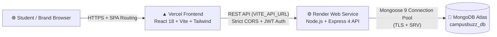

<div align="center">


# 🎓 CampusBuzz — Collegiate Creator & Influencer Management Platform

**CONNECT · CREATE · COLLABORATE**

*India's Premier Full-Stack Collegiate Creator Network, Brand Sponsorship Escrow, Event Portal & Campus Community Hub*

[](https://reactjs.org/)
[](https://vitejs.dev/)
[](https://tailwindcss.com/)
[](https://nodejs.org/)
[](https://www.mongodb.com/atlas)
[](https://campusbuzz-rosy.vercel.app)
[](https://campusbuzz-api.onrender.com/api/health)

[Live App](#-live-deployment) • [Overview](#-overview) • [Architecture](#-system-architecture) • [Key Features](#-key-features) • [Local Setup](#-local-development-setup) • [Cloud Deployment](#-production-deployment-vercel--render--mongodb-atlas) • [API Docs](#-api-endpoints-reference)

</div>

---

## 🌐 Live Deployment

| Service | Provider | Live URL |
| :--- | :--- | :--- |
| **Live Web App** | Vercel | https://campusbuzz-rosy.vercel.app |
| **Backend REST API** | Render (`campusbuzz-api`) | https://campusbuzz-api.onrender.com |
| **API Health Check** | Render | https://campusbuzz-api.onrender.com/api/health |
| **Database Telemetry** | MongoDB Atlas (`campusbuzz_db`) | https://campusbuzz-api.onrender.com/api/db-status |
| **Source Repository** | GitHub | https://github.com/ranjann-07/Campusbuzz |

> **Note:** The backend runs on Render's free tier, so after ~15 minutes of inactivity the first request may take ~15–50 seconds while the server wakes up.

---

## 🌟 Overview

**CampusBuzz** is a production-ready, full-stack creator management and university social platform engineered for student influencers, campus societies, and sponsoring brands across India.

Designed with a sleek dual-theme glassmorphic interface (**Light ☀️ & Dark 🌙**), an interactive physics-driven **BuzzBot 3D Mascot**, and a rich relational dataset (**10,200+ students**, **9,755+ social posts**, **25 campus events**, **20 brand campaigns**, and **6 campus clubs**), CampusBuzz bridges university talent with brand collaborations at scale.

---

## 🏗️ System Architecture



| Layer | Hosting | Tech Stack | Responsibility |
| :--- | :--- | :--- | :--- |
| **Frontend SPA** | **Vercel** | React 18, Vite 6, Tailwind CSS, Framer Motion, Three.js | Responsive UI, interactive visualizations, robot mascot auth, dual theme |
| **REST API** | **Render** | Node.js, Express 4, JWT, `bcryptjs`, `cors` | Auth, search, paginated feeds, campaign/event CRUD, admin governance |
| **Cloud Database** | **MongoDB Atlas** | MongoDB + Mongoose 9 ODM | Cloud persistence, atomic sequences, indexed queries, auto-seeding |

---

## ✨ Key Features

- 🤖 **Interactive BuzzBot Mascot (`InteractiveRobotMascot`)**: Cursor & typing eye-tracking, password hiding/reaction animations, and floating thought bubbles on login/signup.
- 👥 **10,200+ Student Creator Directory**: Search by Student ID (`CB-2026-XXXXX`), name, username, or department; filter across premier institutions (**Shoolini University (781 verified creators)**, Delhi University, IIT Bombay, NIFT Delhi, BITS Pilani, Ashoka University, etc.).
- 👁️ **Slide-Out `DetailDrawer`**: Dedicated `[ 👁️ View ]` button on creator rows & cards opening instant bio, analytics, verified social handles, and live creator posts.
- 🧠 **AI Influencer Match Score Engine**: Dynamic scoring (`0–100`) evaluating engagement rate, category relevance, and authentic follower reach with instant creator recommendations.
- 📅 **Campus Events & Interactive Calendar**: Upcoming fests, hackathons, music nights, and startup conclaves (post-Dec 10, 2026 schedule) with real-time seat RSVP and Card/Calendar view switching.
- 📢 **Live Collegiate Social Feed**: Browse Explore & Trending posts (`9,755+` posts), toggle likes, publish new posts/reels, bookmark favorites, and comment in real time.
- 💼 **Brand Campaigns & Collaboration Chat**: Browse active & completed brand fellowships (Red Bull, Spotify, Notion, OnePlus, Myntra), pitch applications, and chat in collaboration rooms.
- 🏛️ **Campus Clubs & Admin Governance**: Join/leave campus societies, monitor system/database telemetry (`MongoDB Atlas`), and approve/verify creator accounts.
- 🌗 **High-Contrast Light & Dark Modes**: Full WCAG-friendly Light & Dark mode styling, transparent theme-aware logos, collapsible global sidebar drawer, and smooth scroll-to-top navigation.

---

## 📁 Project Structure

```
CampusBuzz/
├── .gitignore                        # Ignores node_modules, .env files, dist/, logs
├── package.json                      # Workspace helper scripts
├── render.yaml                       # Render Blueprint for backend Web Service
├── README.md                         # Full documentation & deployment guide
├── IMPORT_INSTRUCTIONS.md            # Legacy SQL/CSV dataset import notes
│
├── backend/                          # Node.js + Express + Mongoose API
│   ├── .env.example                  # Secure production env var template
│   ├── package.json                  # Express, Mongoose 9, JWT, bcryptjs, cors
│   ├── server.js                     # Express app, CORS, JWT & 28+ REST endpoints
│   ├── config/
│   │   ├── db.js                     # MongoDB Atlas connection pool & dev fallback
│   │   └── seedData.js               # Default charts, activities & starter data
│   ├── models/
│   │   └── index.js                  # Mongoose schemas (Student, Post, Event, Campaign, Club...)
│   ├── data/
│   │   ├── mongo_seed.json.gz        # Compressed full snapshot (10.2K students, 9.7K posts)
│   │   ├── local_db.json             # Local fallback snapshot
│   │   └── csv/                      # Relational CSV exports
│   └── scripts/
│       ├── seedMongo.js              # Idempotent MongoDB Atlas seeder & counter sync
│       └── ...                       # Dataset maintenance utilities
│
└── frontend/                         # React 18 + Vite 6 + Tailwind CSS SPA
    ├── vercel.json                   # Vercel SPA rewrite fallback & security headers
    ├── .env.example                  # Frontend env template (VITE_API_URL)
    ├── vite.config.js                # Dev server (port 3000) & local /api proxy
    ├── tailwind.config.js            # Custom neon colors, animations & dark mode
    ├── package.json                  # React, Framer Motion, Lucide, Canvas Confetti, Three.js
    ├── public/                       # Theme-aware CampusBuzz PNG logos & assets
    └── src/
        ├── App.jsx                   # View router & global modal/drawer orchestration
        ├── index.css                 # Glassmorphism + comprehensive Light/Dark mode styles
        ├── config/
        │   └── api.js                # Centralized VITE_API_URL resolver & auth headers
        ├── context/
        │   └── AppContext.jsx        # Auth state, JWT persistence, theme & global CRUD actions
        ├── components/               # Navbar, GlobalSidebarDrawer, DetailDrawer, RobotMascot, Charts
        └── views/                    # LoginPage, LandingPage, DashboardOverview, Feed, Creators, Events...
```

---

## 🛠️ Local Development Setup

### Prerequisites
- **Node.js** `>= 18.0.0`
- **npm** `>= 9.0.0`
- A **MongoDB Atlas** cluster URI *(optional in local dev: if `MONGODB_URI` is omitted locally, `backend` boots in local snapshot mode using `mongo_seed.json.gz` so the UI remains testable offline).*

### 1. Clone & Install Dependencies
```bash
git clone https://github.com/ranjann-07/Campusbuzz.git
cd Campusbuzz
npm run install:all
```

### 2. Configure Backend Environment (`backend/.env`)
```bash
cp backend/.env.example backend/.env
```
Fill in your local or Atlas values in `backend/.env` (**never commit `.env` files**):
```env
NODE_ENV=development
PORT=5001
JWT_SECRET=your_random_local_secret
MONGODB_URI=mongodb+srv://<username>:<password>@<cluster>.mongodb.net/campusbuzz_db?retryWrites=true&w=majority
MONGODB_DB_NAME=campusbuzz_db
CORS_ORIGIN=http://localhost:3000
```

### 3. Seed MongoDB Atlas (First-Time Setup)
The backend automatically seeds MongoDB Atlas on startup if the `students` collection is empty, or you can run it manually:
```bash
cd backend
npm run seed:mongo
```

### 4. Run Backend & Frontend
Start the Express API (`http://localhost:5001`):
```bash
npm run dev:backend
```
In a second terminal, start the Vite frontend (`http://localhost:3000`):
```bash
npm run dev:frontend
```
Open **[http://localhost:3000/](http://localhost:3000/)** in your browser.

---

## 🚀 Production Deployment (Vercel + Render + MongoDB Atlas)

### 1. MongoDB Atlas Setup
1. Create or select a Cluster (M0 Free Tier or higher) in **MongoDB Atlas**.
2. Create a Database User with `readWrite` access to `campusbuzz_db`.
3. Under **Network Access**, allow your Render outbound IPs (or `0.0.0.0/0` for Render dynamic egress IPs with strong DB user password).
4. Copy the `mongodb+srv://...` connection string.

### 2. Backend Deployment on Render
1. Push this repository to GitHub.
2. In **Render Dashboard** -> **New +** -> **Blueprint** (auto-reads [`render.yaml`](render.yaml)) or **Web Service**:
   - **Root Directory**: `backend`
   - **Build Command**: `npm install`
   - **Start Command**: `npm start`
   - **Health Check Path**: `/api/health`
3. Set Environment Variables in Render:
   | Variable | Description |
   | :--- | :--- |
   | `NODE_ENV` | `production` |
   | `JWT_SECRET` | Strong random secret (auto-generated via `render.yaml`) |
   | `MONGODB_URI` | Your MongoDB Atlas connection URI |
   | `MONGODB_DB_NAME` | `campusbuzz_db` |
   | `FRONTEND_URL` | Your Vercel production URL (`https://campusbuzz-rosy.vercel.app`) |
   | `CORS_ORIGIN` | Comma-separated allowed origins (Vercel URL) |
   | `ALLOW_VERCEL_PREVIEWS` | `true` (allows `*.vercel.app` preview deployments) |

### 3. Frontend Deployment on Vercel
1. Import the GitHub repository into **Vercel**.
2. Set **Root Directory** to `frontend`.
3. Framework Preset: **Vite** (`npm run build`, output directory `dist`). SPA rewrites and security headers are automatically loaded from [`frontend/vercel.json`](frontend/vercel.json).
4. Add Environment Variable in Vercel:
   | Variable | Value |
   | :--- | :--- |
   | `VITE_API_URL` | Your deployed Render backend URL (e.g. `https://campusbuzz-api.onrender.com`) |
5. Deploy and update `CORS_ORIGIN` / `FRONTEND_URL` on Render with your live Vercel domain!

---

## 🔑 Demo Login Accounts

| User | Role | Email | Password | Student ID | College |
| :--- | :--- | :--- | :--- | :--- | :--- |
| **Aanya Sharma** | Collegiate Creator | `aanya@campus.edu` | `password123` | `CB-2026-00001` | Shoolini University |
| **Arjun Mehta** | Tech Creator | `arjun@iitb.ac.in` | `password123` | `CB-2026-00002` | IIT Bombay |
| **Admin Karan** | Superadmin | `admin@campusbuzz.com` | `adminpassword` | `CB-2026-00004` | CampusBuzz HQ |

---

## 🔌 API Endpoints Reference

| Category | Method & Route | Purpose |
| :--- | :--- | :--- |
| **System** | `GET /api/health`, `GET /api/db-status` | Server health & MongoDB Atlas status |
| **Auth** | `POST /api/auth/login`, `POST /api/auth/register` | JWT login (`bcryptjs` verified) & student registration |
| **Dashboard** | `GET /api/dashboard/stats`, `GET /api/analytics`, `GET /api/match-score` | Aggregate stats, AI creator match score & trend graphs |
| **Search** | `GET /api/search?q=...` | Global search across students, creators, posts, events, campaigns & clubs |
| **Students / Creators** | `GET /api/students`, `GET /api/creators`, `POST /api/creators`, `GET /api/students/:id`, `PUT /api/students/:id` | Paginated directory, profile details & creator registration |
| **Social Feed** | `GET /api/posts`, `POST /api/posts`, `DELETE /api/posts/:id`, `POST /api/posts/:id/like`, `GET / POST /api/posts/:id/comments` | Feed pagination, likes & comment threads |
| **Events** | `GET /api/events`, `POST /api/events`, `POST /api/events/:id/register`, `POST /api/events/:id/unregister` | Upcoming/completed events & RSVP seat management |
| **Campaigns** | `GET /api/campaigns`, `POST /api/campaigns`, `POST /api/campaigns/:id/apply`, `POST /api/campaigns/:id/cancel` | Brand briefs, sponsorships & creator applications |
| **Clubs & Collabs** | `GET /api/clubs`, `POST /api/clubs/:id/join`, `POST /api/clubs/:id/leave`, `GET / PUT /api/collaborations/:id`, `GET / POST /api/collaborations/:id/messages` | Student clubs & persistent collaboration chat |
| **Admin** | `GET /api/admin/overview`, `PUT /api/admin/verify-creator/:id` | Admin queue metrics & creator badge verification |

---

<div align="center">

**Built with ❤️ for Collegiate Creators & University Communities**  
*© 2026 CampusBuzz Inc.*

</div>
